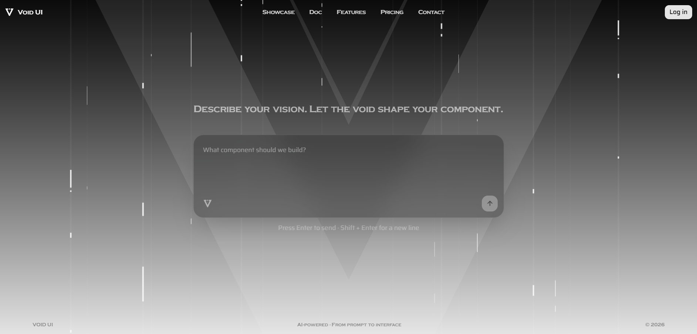
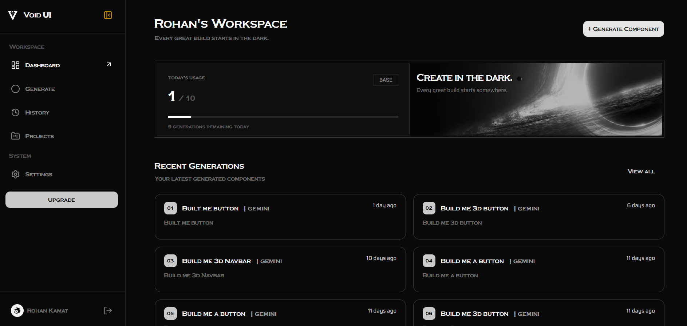
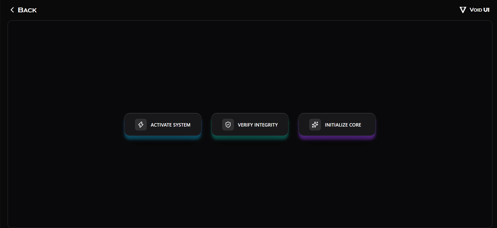
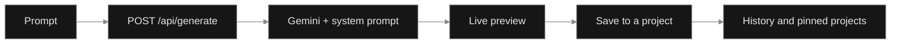

<p align="center">
  
</p>
<h1 align="center">Void UI</h1>

<p align="center">
  Describe an interface in plain words and get a polished, working component back.<br>
  Preview it live, keep it in a project, and ship it.
</p>

<h4 align="center">
  <a href="#showcase">Showcase</a> |
  <a href="#demo">Demo</a> |
  <a href="#quick-start">Quick start</a> |
  <a href="#how-it-works">How it works</a> |
  <a href="#features">Features</a> |
  <a href="#project-structure">Structure</a> |
  <a href="#deployment">Deployment</a> |
  <a href="#contributing">Contributing</a>
</h4>

<p align="center">
  
  
  
  
  <a href="LICENSE"></a>
</p>

<p align="center">
  
  
  
  
  
  
</p>

Void UI turns an idea into an interface. You write what you want in a sentence, the app sends it to Google Gemini with a tuned system prompt, and the generated component appears in a live preview next to your prompt. Happy with it? Save it to a project, pin the ones you like, and come back to them from your history.

<p align="center">
  
</p>

## Demo

<!-- VIDEO SLOT: the poster below (src/components/Documentation/images/video-poster.svg) links to public/Showcase.mp4, which GitHub opens in its built-in video player.
     For an inline player instead: open this README in the GitHub web editor, drag Showcase.mp4 into it, and GitHub inserts a https://github.com/user-attachments/assets/... link.
     Paste that link on its own line in place of the poster below. -->
<p align="center">
  <a href="public/Showcase.mp4">
    
  </a>
</p>

<p align="center">
  <sub>Click the poster to watch the full walkthrough.</sub>
</p>

## Showcase

### Dashboard

Everything lives in one workspace: generate, history, projects, settings and upgrade, one sidebar away.

<!-- IMAGE SLOT 2 (dashboard screenshot): save as src/components/Documentation/images/dashboard.png -->
<table width="100%">
  <tr>
    <td>
      <sub>&#9679; &#9679; &#9679; &nbsp;&nbsp; <b>dashboard</b></sub>
    </td>
  </tr>
  <tr>
    <td>
      
    </td>
  </tr>
</table>

### Generation

Describe a component in plain words and watch it render in the live preview.

<!-- IMAGE SLOT 3 (generation screenshot): save as src/components/Documentation/images/generate.png -->
<table width="100%">
  <tr>
    <td>
      <sub>&#9679; &#9679; &#9679; &nbsp;&nbsp; <b>generate</b></sub>
    </td>
  </tr>
  <tr>
    <td>
      
    </td>
  </tr>
</table>

<p align="center">
  
</p>

<p align="center">
  
</p>

## Highlights

|                |                                                                                           |
| -------------- | ----------------------------------------------------------------------------------------- |
| Prompt to UI   | Describe a component in plain language and get a finished one back                        |
| Live preview   | See the generated component render as soon as it is ready                                 |
| Projects       | Group generations into projects and pin the ones you want close                           |
| History        | Every generation is saved, so you can reopen and compare earlier results                  |
| Sign in        | Google sign-in through NextAuth, with sessions stored in PostgreSQL                       |
| Billing        | Checkout and webhook handling through Dodo Payments, with an upgrade page in the dashboard |
| Type safety    | TypeScript end to end, with Zod schemas validating every request body                     |
| Ready to ship  | Dockerfile and Compose file included                                                      |


## Quick start

```bash
# 1. Clone the repository
git clone https://github.com/holyarsenic/Void-UI.git
cd Void-UI

# 2. Install dependencies
npm install

# 3. Start the dev server
npm run dev
```

Then open [http://localhost:3000](http://localhost:3000).

Before the app can generate, sign you in, or take payments, create a `.env` file in the project root with:

- your PostgreSQL connection string for Prisma
- a NextAuth secret
- your Google OAuth client credentials
- a Google Gemini API key
- your Dodo Payments keys

<!-- Add the exact variable names from your code here, for example in a fenced env block. -->

Next.js 16 works best on a current Node.js release, so Node.js 20 or newer is recommended. The repository also includes a `pnpm-workspace.yaml`, so `pnpm install` works too.

## How it works



1. **Prompt.** You describe the interface on the generate page.
2. **Generate.** The request is validated with a Zod schema and sent to `/api/generate`, which calls Google Gemini through `@google/genai` using the system prompt in `src/prompt/systemPrompt.ts`.
3. **Preview.** The result is shown right away in the live preview panel.
4. **Save.** Keep it in a project. Pin a project to keep it at the top of your list.
5. **Revisit.** Every generation is stored with your account and shows up in history.

Authentication runs through NextAuth with the Prisma adapter, and billing runs through Dodo Payments with a checkout route and a webhook route.

## Features

- **Prompt-driven generation** with a purpose-built system prompt
- **Live preview** of generated components
- **Recent generations** list on the generate page
- **Projects** with create, rename, delete and pin
- **Generation history** page
- **Settings** page for your account
- **Upgrade** page with checkout and webhook-based billing
- **Landing site** with hero, feature, showcase and sign-up sections
- **Animated interface** built with Motion and light-line effects
- **Docker support** for local runs and deployment

## Tech stack

| Area           | What is used                                                  |
| -------------- | ------------------------------------------------------------- |
| Framework      | Next.js 16 (App Router)                                       |
| Language       | TypeScript                                                    |
| Styling        | Tailwind CSS, class-variance-authority, clsx                  |
| UI             | Base UI, Lucide icons, Motion                                 |
| Database       | PostgreSQL with Prisma 7 and the `@prisma/adapter-pg` driver  |
| Auth           | NextAuth with the Prisma adapter                              |
| AI             | Google Gemini through `@google/genai`                         |
| Payments       | Dodo Payments                                                 |
| Validation     | Zod                                                           |
| Tooling        | ESLint, Husky pre-commit hook, Docker                         |

## Data model

Prisma manages five models: `User`, `Account`, `Session`, `Project` and `Generation`. Migrations live in `src/prisma/migrations`, and the schema is in `src/prisma/schema.prisma`.

## Available scripts

<details>
<summary><b>Show all scripts</b></summary>

| Script                  | What it does                              |
| ----------------------- | ----------------------------------------- |
| `npm run dev`           | Starts the development server             |
| `npm run build`         | Creates a production build                |
| `npm run start`         | Runs the production build                 |
| `npm run lint`          | Runs ESLint                               |
| `npm run typecheck`     | Runs the TypeScript compiler without emit |
| `npm run prepare`       | Sets up the Husky git hooks               |
| `npm run postinstall`   | Runs automatically after install          |
| `npm run contract:emit` | Emits the Prisma contract                 |

</details>

## API endpoints

<details>
<summary><b>Show all endpoints</b></summary>

| Endpoint                   | Purpose                                  |
| :------------------------- | :--------------------------------------- |
| `/api/auth/[...nextauth]`  | NextAuth sign-in, sign-out and session   |
| `/api/generate`            | Generates a component from a prompt      |
| `/api/projects`            | Lists and creates projects               |
| `/api/projects/[id]`       | Operations on a single project           |
| `/api/projects/[id]/pin`   | Pins or unpins a project                 |
| `/api/billing/checkout`    | Starts a checkout session                |
| `/api/billing/webhook`     | Receives payment events                  |

</details>

## Project structure

<details>
<summary><b>Show the folder layout</b></summary>

```
.
├── .husky/                  pre-commit hook
├── public/                  logo, showcase video and static images
├── src/
│   ├── app/
│   │   ├── api/             auth, billing, generate and projects routes
│   │   ├── auth/login/      sign-in page
│   │   └── dashboard/       generate, history, projects, settings, upgrade
│   ├── assets/              icons and logo components
│   ├── components/
│   │   ├── Auth/            login page
│   │   ├── Dashboard/       generate, live preview, recent generations, sidebar
│   │   ├── Landing/         hero, features, showcase, enroll, footer
│   │   ├── Loading/         auth and generation loaders
│   │   └── ui/              navbar, workflow, buttons, light lines
│   ├── generated/           Prisma client output
│   ├── lib/                 auth, prisma and utils
│   ├── prisma/              schema and migrations
│   ├── prompt/              the system prompt
│   └── schemas/             Zod schemas for billing, checkout, generate, project, user
├── Dockerfile
├── compose.yaml
├── prisma.config.ts
├── next.config.ts
└── package.json
```

</details>

## Deployment

Build and run the container:

```bash
docker build -t void-ui .
docker run -p 3000:3000 --env-file .env void-ui
```

A `compose.yaml` and a `README.Docker.md` are included for Compose-based setups.

## Contributing

Contributions are welcome. The standard flow:

1. **Fork** the repository
2. **Clone** your fork: `git clone https://github.com/<your-username>/Void-UI.git`
3. **Branch**: `git checkout -b feature/your-feature`
4. **Commit**: `git commit -m "feat: add some feature"`
5. **Push**: `git push origin feature/your-feature`
6. **Open** a pull request

Please follow the existing code style. A pre-commit hook runs on staged files, and before you open a pull request, run:

```bash
npm run lint
npm run typecheck
```

Ideas and bug reports are welcome in [issues](https://github.com/holyarsenic/Void-UI/issues).

## Star history

<a href="https://star-history.com/#holyarsenic/Void-UI&Date">
  <picture>
    <source media="(prefers-color-scheme: dark)" srcset="https://api.star-history.com/svg?repos=holyarsenic/Void-UI&type=Date&theme=dark" />
    <source media="(prefers-color-scheme: light)" srcset="https://api.star-history.com/svg?repos=holyarsenic/Void-UI&type=Date" />
    
  </picture>
</a>

## License

Void UI is licensed under the [MIT License](LICENSE).

<p align="right">
  <sub>Made by <a href="https://github.com/holyarsenic">holyarsenic</a></sub>
</p>